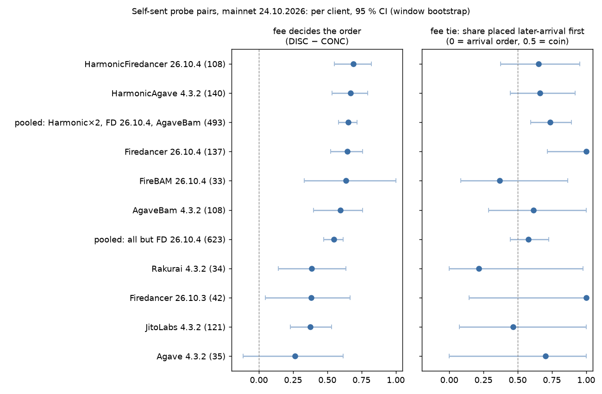

# Inside the Block: how Solana validators order transactions — report

Mainnet-beta, 24.10.2026, epoch 1066, three days after Alpenglow was activated (epoch 1064). solana-core 4.3.2
on the RPC side; slots are 210.7 ms; leader windows are 4 slots (≈ 840 ms).
Generated tables and figures: [results.md](results.md). Code and one-command reproduction: [../README.md](../README.md).

## TL;DR

- **The question** is which rule a validator uses to order transactions inside its block: priority fee,
  arrival time, or something else, and how strictly, for each validator client.
- **Data.** A panel of **20 validators in 10 client/version groups** (Agave, Agave 4.5 alpha, Jito, Agave-BAM,
  Harmonic-Agave, Rakurai, Firedancer 26.10.3 and 26.10.4, Harmonic-Firedancer, FireBAM), plus 110 other
  validators for a cross-section check. **6600 self-sent probes** in 1100 of the panel's leader windows
  (0.039 SOL spent), **5008 landed**; ≈ 6200 real blocks read.
- **Controlled probes** (section 3.3). Probes are sent in pairs straight to the leader's TPU, with a fixed send
  gap. Pooled over all clients:
  - when the cheaper tx is sent first, the pricier one gets ahead of it in **61 %** of pairs;
  - with equal fees, the second-sent one is ahead in **41 %**;
  - when the pricier tx is sent first, the cheaper one gets ahead in only **4 %**.

  This fits one simple rule in every client: *txs that wait in the leader's buffer together are sorted by
  fee; otherwise arrival order is kept.* The three arms pin down two numbers per client
  ([figure](figures/sort_model.png), section 3.3):
  - **how often the fee decides** (FDS = DISC − CONC): **+0.57** [+0.51, +0.62] pooled, +0.71 at a 0 ms gap.
    Firedancer, Harmonic and Agave-BAM sit at 0.60–0.69. **Jito sorts by fee less often: 0.38**, −0.28
    [−0.44, −0.11] below those four pooled;
  - **how a fee tie is broken** (TAU): close to a coin flip (0.47–0.66) in the other clients with enough
    pairs, but **Firedancer 26.10.4 puts the later arrival first: 1.00** [0.72, 1.00];
  - **what "fee" means.** The tx with the higher total fee but the lower `cu_price` goes first in 85 % of
    pairs, so `cu_price` is not the sort key.

  These are **exploratory**: the model was found after looking at the data. The pre-registered test (FPI =
  DISC − EQ, +0.20 [+0.12, +0.28] pooled) gives no client a clean "fee priority" or "FIFO" verdict: 5 are
  "mixed / weak" and 5 have too few pairs. FPI turned out to mix the two numbers above (section 5).
- **Run 2 is pre-registered and ready, not yet run** (section 3.4). It tests the model's claims as seven
  fixed checks on new data: 47 validators, including 27 new ones, and probes that fix the ratio arm's
  confound. On run 1, five of the seven hold, one cannot hold by design, and one has no data yet.
- **Real blocks** (section 3.1). At the **start of a leader's window**, BAM front-ends put higher-fee txs
  first:
  - Agave-BAM: ρ −0.48 on 17 other validators, −0.49 in 179 live-run windows;
  - FireBAM: ρ −0.52 on 10 other validators, −0.42 in 107 windows.

  Jito, Agave and Harmonic do so weakly or not at all. This replicated on a hold-out sample, inside the
  live-run windows, and in a **pre-registered cross-section of 110 other validators**: 3 of 4 predictions held.
  The prediction that every group matches its panel validator failed for 2 of 7 groups (Firedancer 26.10.4 and
  Agave). Across a whole block, fee and position are unrelated for every client.
- **Who you send to is not who builds the block.** 66 % of stake sits behind shared front-end IPs (BAM nodes,
  Harmonic relays). 596 of the 603 direct-TPU probes that landed with a leader other than the target landed
  with a leader behind the *same* IP. Landing rates differ by front-end: Harmonic 98–99 %, FireBAM 28 %.

## 1. Why the obvious experiment does not answer the question

The first-instinct design ([notes/v0-default.md](../notes/v0-default.md)) is the one most people will submit:
send a handful of txs with different fees through public RPC, find them in a block, correlate fee with
position. It cannot answer the question, for six reasons ([notes/critique.md](../notes/critique.md), round 1):

1. **Arrival order is unknown.** Txs sent together through RPC arrive in random order. "High fee came first"
   then fits both a fee rule and a FIFO rule with lucky arrival.
2. **No noise floor.** Without equal-fee pairs nobody knows how often order flips for no reason at all.
3. **One payer means every pair conflicts.** Txs that write the same account are serialised; the result
   mixes the ordering policy with lock handling.
4. **RPC forwards to several leaders.** Probes land in other validators' blocks; the "client" being measured
   is not the one targeted.
5. **Pairs in one block are not independent.** Treating them as such makes the confidence intervals too narrow.
6. **Whole-block correlations are ≈ 0 under streaming block building**, even for a scheduler that does sort
   its buffer by priority (shown below with real data).

The one visible competing submission (github.com/zdfgu113/inside-the-block, read 24.10.2026) has points
1–5; its 135 pairs reduce to 40 that landed with the targeted leader.

## 2. Design

Full description: [README → Design](../README.md#design). Pre-registered rules:
[notes/preregistration.md](../notes/preregistration.md) (git-dated before any live data).

- **Direct to the leader.** Each probe goes over QUIC to the target leader's TPU only, so it can land in
  that leader's block or nowhere. The leader is then re-checked from the block's own `Fee` reward.
- **Pairs with a controlled gap.** The first tx is sent, then the second `dt ∈ {0, 30, 150}` ms later, with
  nanosecond send timestamps. The outcome is binary: did the second-sent tx end up earlier in the block?
- **Arms that isolate one thing each.** Equal fees (noise floor), low→high (fee and arrival disagree),
  high→low (they agree), shared vs separate payer (write-lock conflict or not), and a per-CU vs total-fee
  arm (RA has the higher price per CU, RB the higher total fee).
- **Phase.** PRE: both txs arrive ≈ 1.2 slots before the window, so both wait in the leader's buffer. IN:
  they arrive while the block streams.
- **Statistics.** The fee-priority index `FPI = overtake(low→high) − overtake(equal)`. Confidence intervals
  come from a cluster bootstrap over leader windows; the per-group test is Holm-corrected; a group with
  fewer than 20 usable pairs per arm gets "insufficient data", never a guess.

## 3. Results

### 3.1 Passive layer: 475 blocks from the panel's own leader windows

Every block of 6 recent leader windows of each of the 20 validators (480 slots, 5 skipped, 18:09–00:51
UTC 23–24.10.2026). Jito-tip txs and failed txs are excluded. ρ is the Spearman rank correlation between
position and priority fee per CU; **ρ < 0 means higher fee → earlier**. CIs: bootstrap by block.

| group | whole block | first 64 txs, any block | first 64 txs, window's 1st block |
|---|---|---|---|
| AgaveBam 4.3.2 | −0.08 [−0.10, −0.06] | −0.36 [−0.42, −0.31] | **−0.57 [−0.64, −0.49]** |
| FireBAM 26.10.4 | −0.04 [−0.07, −0.01] | −0.26 [−0.33, −0.19] | **−0.41 [−0.55, −0.26]** |
| Firedancer 26.10.3 | −0.04 [−0.06, −0.02] | −0.10 [−0.15, −0.05] | **−0.29 [−0.41, −0.19]** |
| JitoLabs 4.3.2 | +0.00 [−0.02, 0.03] | −0.06 [−0.11, −0.01] | −0.16 [−0.25, −0.08] |
| Agave 4.3.2 | −0.02 [−0.05, 0.02] | −0.08 [−0.13, −0.03] | −0.15 [−0.27, −0.04] |
| Agave 4.5.0-alpha.2 | −0.04 [−0.09, −0.00] | −0.09 [−0.16, −0.04] | −0.10 [−0.23, 0.03] |
| HarmonicAgave 4.3.2 | −0.01 [−0.04, 0.03] | −0.09 [−0.12, −0.06] | −0.03 [−0.12, 0.05] |
| HarmonicFiredancer 26.10.4 | −0.04 [−0.08, −0.01] | −0.11 [−0.18, −0.05] | −0.03 [−0.18, 0.12] |
| Rakurai 4.3.2 | +0.02 [−0.01, 0.05] | −0.02 [−0.07, 0.02] | −0.01 [−0.14, 0.10] |
| Firedancer 26.10.4 | −0.02 [−0.06, 0.01] | −0.01 [−0.08, 0.06] | +0.08 [−0.06, 0.23] |

**How to read it.** After Alpenglow, blocks are built while they stream. A scheduler that keeps its buffer
sorted by priority shows that order only where it drains a backlog: at the start of the leader's window.
Later txs are placed roughly as they arrive, so whole-block correlations are ≈ 0 for every client, including
those that do sort. A whole-block correlation, the usual first analysis, would conclude "no fee ordering
anywhere".

**Robustness** (critique round 3; `scripts/robustness_head.py`, output in
[data/results/robustness_head.txt](../data/results/robustness_head.txt)):
- *Placebo:* the same statistic on txs 128–191 of the same blocks is ≈ 0 (−0.08 … +0.02) for the three
  strong groups. The effect is specific to the head.
- *Both validators agree* in the strong groups (AgaveBam −0.51 / −0.56, FireBAM −0.47 / −0.56,
  Firedancer 26.10.3 −0.41 / −0.30). In Firedancer 26.10.4 they don't (+0.26 / −0.11).
- *Unpriced txs:* dropping price-0 txs keeps the strong groups negative and makes Agave 4.3.2 clearly
  negative too (−0.46): many unpriced txs sit early in Agave's head and mask a fee order among priced ones.
- *Top-fee txs* (block's top 10 %) are 1.5–3.2× over-represented in the head of every group.

**What it does not show.** Other senders' arrival times are unknown. High-fee bots may simply aim at the slot
start, and that alone would give the same head pattern. BAM bundles without a Jito tip cannot be excluded.
The head tests were added after seeing data (**exploratory**), so they were then checked three more times.
The checks used new data: a hold-out sample, the live-run windows, and a pre-registered cross-section.

**Replication** (critique round 4; `scripts/replication_head.py`,
[data/results/replication_head.txt](../data/results/replication_head.txt)). The table shows head ρ in the
window's 1st block, for the same panel validators:

| group | discovery (12 blocks) | hold-out (21–31 blocks) | live-run windows (n blocks) |
|---|---|---|---|
| AgaveBam 4.3.2 | −0.57 | −0.57 | −0.49 (179) |
| FireBAM 26.10.4 | −0.41 | −0.40 | −0.42 (107) |
| Firedancer 26.10.3 | −0.29 | −0.28 | −0.18 (54) |
| JitoLabs 4.3.2 | −0.16 | −0.13 | −0.12 (176) |
| Agave 4.3.2 | −0.15 | −0.17 | −0.10 (61) |
| Rakurai 4.3.2 | −0.01 | −0.14 | −0.15 (50) |
| HarmonicAgave 4.3.2 | −0.03 | −0.08 | −0.09 (208) |
| HarmonicFiredancer 26.10.4 | −0.03 | −0.05 | −0.11 (178) |
| Firedancer 26.10.4 | +0.08 | −0.07 | −0.03 (178) |

**A backlog effect, not a slot-start effect** (`scripts/backlog_head.py`,
[backlog_head.txt](../data/results/backlog_head.txt)). The head order is stronger in the window's 1st block than in
blocks 2–4. The difference is −0.15 [−0.20, −0.12] for AgaveBam, −0.18 for FireBAM, −0.16 for Firedancer
26.10.3 and −0.20 for Jito. Only the 1st block starts from a buffer that filled up while another leader was
producing. In Firedancer 26.10.4 and both Harmonic groups there is no difference.

**Cross-section, pre-registered** ([notes/preregistration-frontend.md](../notes/preregistration-frontend.md),
committed before the fetch; `scripts/frontend_sample.py`, [frontend_sample.txt](../data/results/frontend_sample.txt)).
The sample is 239 window-first blocks of **110 validators that are not in the panel**. The statistic is the
mean head ρ per validator, averaged over validators; the CI comes from a bootstrap over validators.

| group | validators | cross-section | panel (hold-out) | H1: within ±0.15 |
|---|---|---|---|---|
| FireBAM 26.10.4 | 10 | −0.52 [−0.58, −0.45] | −0.40 | yes |
| AgaveBam 4.3.2 | 17 | −0.48 [−0.54, −0.43] | −0.57 | yes |
| Firedancer 26.10.4 | 16 | −0.28 [−0.37, −0.19] | −0.07 | **no** |
| JitoLabs 4.3.2 | 19 | −0.09 [−0.14, −0.04] | −0.13 | yes |
| HarmonicFiredancer 26.10.4 | 16 | −0.05 [−0.10, +0.01] | −0.05 | yes |
| HarmonicAgave 4.3.2 | 16 | −0.04 [−0.11, +0.02] | −0.08 | yes |
| Agave 4.3.2 | 9 | +0.01 [−0.08, +0.09] | −0.17 | **no** |
| Rakurai 4.3.2 | 7 | −0.02 [−0.11, +0.07] | −0.14 | (n < 8) |

- **H1** holds for 5 of 7 groups. It **failed** for Firedancer 26.10.4 and Agave: their two panel validators
  are not typical of their client. Firedancer 26.10.4 validators range from −0.74 to +0.12. In both groups,
  operator settings matter as much as the client.
- **H2** holds. Agave-BAM minus Jito is −0.40 [−0.48, −0.32]. The two run the same Agave 4.3.2 code base, so
  the difference comes from the BAM front-end, not from the validator software.
- **H3** holds: both Harmonic groups are flat.
- **H4** holds: every BAM node IP with 3 sampled validators has a mean of −0.43 to −0.60. FireBAM validators
  behind the same BAM nodes show the same order as Agave-BAM ones.

**Shared front-ends** (`scripts/shared_tpu.py`, [shared_tpu.txt](../data/results/shared_tpu.txt)). 66 % of
stake advertises a `tpuQuic` address that ≥ 3 identities share: 96 % of Agave-BAM stake, 95 % of FireBAM and
100 % of Harmonic. A tx sent "to a leader" there goes to a relay that serves many leaders. The live run shows
it directly. Of the 603 direct-TPU probes that landed with a leader other than the target, 596 landed with a
leader that advertises the target's IP.

### 3.2 Timing layer: can the pipeline hit a 4-slot window from Ukraine?

Two mainnet dry-runs (real leader schedule, real QUIC connections, sends timed and logged, no signature
broadcast). Aim is the estimated slot at send, relative to the window start.

| path, phase | target | dry-run 1 (39 windows), median | dry-run 2 (25 windows), median [range] |
|---|---|---|---|
| TPU, PRE | −1.2 | −1.57 | −0.74 [−1.80, +1.25] |
| TPU, IN | +0.5…+2.4 | +0.65 | +1.84 [−0.09, +4.27] |
| RPC, PRE | −1.2 | −3.56 | −1.18 [−1.57, +0.54] |
| RPC, IN | +0.5…+2.4 | −1.93 | +1.56 [+0.88, +2.27] |

Between the two runs the slot clock was fixed (least-squares slot length instead of the median gap between
websocket notifications; critique round 2, item 2). Tails of −8 to −13 slots disappeared. QUIC handshakes to
leaders took 27–282 ms, RTT 33–186 ms. 2.7 % of sends in dry-run 2 left more than 50 ms after plan, all in
one window; amendment A1 marks such pairs as not usable.

### 3.3 Active layer: 6600 probes in 1100 leader windows

**The run.** It ran on 24.10.2026, 01:57–04:23 UTC (run `20261024T015728Z-mainnet-live`), with a key the owner
funded. 3300 pairs went to the 20 panel validators. 5622 probes went straight to the leader's TPU over QUIC;
978 went through public RPC as a comparison. The run spent **0.0389 SOL** in fees. The 12 sub-payers were
swept back afterwards. Each probe is found again by signature; `landed.jsonl` holds its slot, position and
the leader that built the block. Pooled tables and CIs come from
[data/results/live_analysis.txt](../data/results/live_analysis.txt) (`scripts/live_analysis.py`). The CIs use a
bootstrap over leader windows.

**Pre-registered per-client verdicts** ([results.md](results.md)). No client gets "fee priority" or "FIFO".
AgaveBam, Firedancer 26.10.4, HarmonicAgave, HarmonicFiredancer and Jito are **"mixed / weak"**. Four of them
have an FPI of about +0.2, below the pre-registered bar: a lower CI bound above 0.2. Their Holm-adjusted p is
0.036 for HarmonicAgave and 0.06–0.08 for the others. Firedancer 26.10.4 has an FPI of about 0. Agave, Agave 4.5, FireBAM, Firedancer 26.10.3 and Rakurai have **"insufficient data"**:
fewer than 20 usable pairs in some arm. Those verdicts stand. Everything below is **exploratory**, chosen after
seeing the data.

**Landing.** Of all probes, 72 % [69, 74] of direct-TPU probes landed, and 100 % of RPC ones. The landing rate
does not depend on fee level (70–75 %), gap or role. It does depend on punctuality: 54 % for sends more than
50 ms late, 74 % on time. It depends most on the front-end:

| group | landed (TPU) |
|---|---|
| HarmonicFiredancer 26.10.4 | 99 % |
| HarmonicAgave 4.3.2 | 98 % |
| Firedancer 26.10.4 | 77 % |
| Firedancer 26.10.3 | 71 % |
| JitoLabs 4.3.2 | 63 % |
| Rakurai 4.3.2 | 61 % |
| AgaveBam 4.3.2 | 58 % |
| Agave 4.3.2 | 45 % |
| FireBAM 26.10.4 | 28 % |

Some probes landed somewhere other than the target's current window:
- 1193 landed with another leader. 590 of these went through RPC, as expected. 596 of the 603 direct-TPU ones
  landed with a leader behind the same front-end IP (section 3.1).
- 391 landed in a *later* window of the same leader, 4–152 slots on, mostly in Harmonic-Agave and Firedancer
  26.10.4. Their blockhash was still valid, so they sat in the buffer.

**Order inside a block.** 1987 pairs had both probes in one block. 1410 of them are usable: on target, and
sent no more than 50 ms late.

| arm | what is sent | usable pairs | 2nd-sent placed first | at dt 0 / 30 / 150 ms |
|---|---|---|---|---|
| DISC | cheap, then pricy (one payer) | 339 | **61 %** [55, 66] | 80 / 51 / 46 % |
| EQ | equal fee (one payer) | 229 | **41 %** [34, 47] | 52 / 36 / 26 % |
| CONC | pricy, then cheap (one payer) | 192 | **4 %** [2, 7] | 9 / 0 / 2 % |
| DISC_SEP / EQ_SEP | as DISC / EQ, two payers | 220 / 161 | 55 % / 40 % | |
| RATIO_AB | RA, then RB | 132 | 71 % | |
| RATIO_BA | RB, then RA | 137 | 2 % | |

- **Fee-priority index** FPI = DISC − EQ: +0.20 [+0.12, +0.28]. It is +0.29 at dt 0, +0.25 when both are sent
  before the window (PRE) and +0.14 inside it (IN). Without a shared account (DISC_SEP − EQ_SEP) it is
  +0.15 [+0.05, +0.26]. So write-lock conflicts are not what drives it.
- **One model fits all three arms.** A pair is either sorted by the scheduler's rule (probability *s*: both
  txs waited in the buffer together) or kept in arrival order up to a small noise *e*. A fee tie under the
  rule goes to the later arrival with probability τ. With one payer:

  DISC = *s* + (1−*s*)*e*, CONC = (1−*s*)*e*, EQ = *s*τ + (1−*s*)*e*

  so **FDS = DISC − CONC** is the share of pairs where the fee, not arrival, decides, and
  **TAU = (EQ − CONC) / FDS** is the tie rule (0 = earlier arrival first, 0.5 = coin, 1 = later first).
  Pooled: FDS **+0.57** [+0.51, +0.62], TAU 0.64 [0.52, 0.78]. FDS falls with the gap, +0.71 / +0.51 / +0.44
  at 0 / 30 / 150 ms, just as the share of pairs that wait together shrinks; TAU stays at 0.54–0.71.
  **A cheaper tx sent after a pricier one almost never gets ahead of it, in any client** (CONC 0–19 % per
  group). [data/results/sort_model.txt](../data/results/sort_model.txt) (`scripts/sort_model.py`) has every
  table; CIs are window-bootstrap.
- **Per client** (exploratory; groups with ≥ 10 DISC and ≥ 5 CONC pairs):

  

  | client | pairs DISC / CONC / EQ | FDS: fee decides | TAU: tie rule | reading |
  |---|---|---|---|---|
  | HarmonicFiredancer 26.10.4 | 42 / 35 / 31 | +0.69 [+0.55, +0.82] | 0.65 [0.38, 0.95] | fee-sorts, ties ≈ coin |
  | HarmonicAgave 4.3.2 | 67 / 31 / 42 | +0.67 [+0.53, +0.80] | 0.66 [0.45, 0.92] | fee-sorts, ties ≈ coin |
  | Firedancer 26.10.4 | 76 / 31 / 30 | +0.64 [+0.53, +0.76] | **1.00** [0.72, 1.00] | fee-sorts, **later arrival wins ties** |
  | FireBAM 26.10.4 | 11 / 5 / 17 | +0.64 [+0.33, +1.00] | 0.37 [0.09, 0.87] | few pairs |
  | AgaveBam 4.3.2 | 51 / 22 / 35 | +0.60 [+0.40, +0.76] | 0.62 [0.29, 1.00] | fee-sorts, ties ≈ coin |
  | JitoLabs 4.3.2 | 54 / 33 / 34 | **+0.38** [+0.23, +0.53] | 0.47 [0.07, 1.00] | **fee decides less often** |
  | Rakurai 4.3.2 | 13 / 9 / 12 | +0.38 [+0.14, +0.64] | 0.22 [0.00, 0.98] | few pairs |
  | Firedancer 26.10.3 | 14 / 16 / 12 | +0.38 [+0.05, +0.67] | 1.00 [0.15, 1.00] | few pairs |
  | Agave 4.3.2 | 11 / 10 / 14 | +0.26 [−0.11, +0.62] | 0.70 [0.00, 1.00] | few pairs |

  Two contrasts clear zero. **Jito's FDS is 0.28 lower** than that of HarmonicAgave, HarmonicFiredancer,
  Firedancer 26.10.4 and AgaveBam pooled: −0.28 [−0.44, −0.11]. Jito runs the same Agave scheduler, so a
  plausible cause is its block-engine stage holding txs, which leaves fewer of our pairs waiting together;
  we did not test that. **Firedancer 26.10.4's TAU is 0.42 higher** than that of all other groups pooled:
  +0.42 [+0.11, +0.54]. That is why its FPI is ≈ 0 although it sorts by fee as often as anyone. **FPI = FDS ×
  (1 − TAU) mixes the two numbers, and understates fee priority whenever ties are not broken by arrival
  order** (section 5).
- **The scheduler ranks by fee per *estimated* cost, not by the `cu_price` field.** RA has the higher
  `cu_price`, RB the higher total fee. RB goes first in **85 %** [80, 89] of pairs, and in 73–94 % in every
  client. The probes use 450 CU. Their estimated cost includes the default 64 MiB loaded-accounts allowance
  (16,384 CU), so RB is ahead on fee per estimated cost unit as well (≈ 0.26 vs 0.17). A total-fee rule and a
  fee-per-estimated-cost rule give the same order here, so the arm could not separate them (section 5).

**What it does not show.** We see only our own pairs. How the scheduler treats a full buffer of other txs is
inferred, not observed. Per-client arms hold 3–76 usable pairs, enough for the pooled model but not for firm
per-client claims. Unstaked QUIC senders get a small quota, so probes that never landed may have been dropped
by QoS rather than by the scheduler. The model assumes the "sorted together" share *s* is the same for the
DISC, CONC and EQ arms; that holds by design (the arms differ only in fee levels and are randomised within a
window), but it is an assumption.

### 3.4 Run 2: pre-registered, ready, not yet run

The model above was found after looking at run 1, so on run 1 it is a hypothesis, not a result.
[notes/preregistration-v2.md](../notes/preregistration-v2.md) (commit 3b49c8c, before any run-2 probe) turns it
into seven checks for a new run. `scripts/live2.sh` runs it; it spends ≈ 0.04 SOL, and the owner of the key
starts it.

- **Panel v2**: 47 validators, the top 5 by stake in each group. That is 27 more than run 1, from a fresh
  survey (`data/panel-v2.json`).
- **Probes** add `SetLoadedAccountsDataSizeLimit(32768)` as the first instruction. Their estimated cost is then
  ≈ 1,630 CU for RA and ≈ 7,030 CU for RB. RA wins on `cu_price` and on fee per estimated cost; RB wins only on
  total fee. Simulated on mainnet: 4 instructions, 600 CU, within the 600-CU limit.
- Everything else is unchanged.

| id | claim | holds if | run 1 (exploratory) |
|---|---|---|---|
| C1 | the fee decides most pairs | pooled FDS lower CI > 0.30 | holds: +0.57 [+0.51, +0.62] |
| C2 | a cheaper later tx almost never passes | CONC upper CI ≤ 0.10 | holds |
| C3 | Jito sorts by fee less often | FDS(Jito) − FDS(4 fee-sorters pooled) upper CI < 0 | holds: −0.28 [−0.44, −0.11] |
| C4 | Firedancer 26.10.4 gives ties to the later arrival | TAU lower CI > 0.5 | holds: 1.00 [0.72, 1.00] |
| C5 | … more than the other clients | TAU difference lower CI > 0 | holds: +0.42 [+0.11, +0.54] |
| C6 | with the cap, fee per cost beats total fee | RB-first share upper CI < −0.2 | fails, as the uncapped design predicts (+0.69) |
| C7 | not a property of the 20 run-1 validators | FDS on new validators lower CI > 0.30 | no new validators yet |

C6 is the sharpest test. The same two probes, plus one instruction that changes only the cost estimate,
should flip from "RB first in 85 %" to "RA first". If the scheduler sorted by total fee, they would not flip.

## 4. Deviations from pre-registration

- **A1** (before live data): pairs sent > 50 ms late are not usable.
- **Head-of-block rank tests** (first 64 txs of a block, and of the window's first block) were added after
  seeing the first passive data. They are **exploratory**, not pre-registered, and no verdict rests on them.
- **v1 parser fix.** Passive data collected before the fix were discarded and collected again.
- **Run size.** The earlier report budgeted ≈ 350 windows; the run did 1100 (cap 0.08 SOL), because the owner
  funded more. The pre-registration fixed no sample size. The analysis code and the rules were not changed.
- **Exploratory live tables**, added after seeing the live data: the mirror index EQ − CONC, tie-breaking per
  client, RB-first per client, the arm × gap breakdown, and the FDS / TAU model with its client contrasts
  (`scripts/sort_model.py`). No run-1 verdict rests on them; they are the hypotheses of run 2 (section 3.4).
- **Cross-section** (section 3.1) has its own pre-registration, committed before its fetch. It is reported in
  full, including the failed H1.

## 5. What went wrong, and what it taught

- **v1 transactions hide their priority fee in a new place.** After Alpenglow most txs are version 1, which
  put the compute budget in `transactionConfig`, not in ComputeBudget instructions. Our first parser read them
  as "no fee", and the first passive result (higher-fee txs *later* at the block head) came from that.
  It was found by chasing an oddly high share of zero-price txs. Any analysis on post-Alpenglow blocks that
  only decodes ComputeBudget instructions has the same bug.
- **The median-gap slot clock** was 5 % off and moved the aim by whole slots.
- **Late sends** cluster in windows where the connection to the leader is slow.
- **The RATIO arm tested less than it was built to.** It was meant to separate "fee per CU" from "total fee".
  But the scheduler's cost estimate is not the `cu_limit`. It adds signature, write-lock and loaded-data costs,
  and without an explicit loaded-accounts-data limit, the default 64 MiB allowance alone is 16,384 CU. With
  that, RB has both the higher total fee and the higher fee per estimated cost unit. The arm still shows that
  the `cu_price` field is not the sort key (RB first in 85 %). Separating the two rules needs probes that set
  `SetLoadedAccountsDataSizeLimit`, so `cu_limit` dominates the cost. Run 2 does (section 3.4).
- **FPI assumes that ties keep arrival order.** It subtracts the equal-fee overtake rate as "noise". A client
  that breaks ties for the later arrival (Firedancer 26.10.4: 73 %) gets FPI ≈ 0 even though it never lets a
  cheaper later tx pass a pricier one (CONC 0 %). The pre-registration should have used CONC as well. A
  rule on both sides, DISC − CONC or EQ − CONC, does not depend on how ties are broken. Section 3.3 now
  reports both numbers, FDS and TAU, and run 2 pre-registers them.
- **Two panel validators do not make a client.** Firedancer 26.10.4's panel validators showed no head order;
  16 others show −0.28. The cross-section caught this. Without it the report would have called Firedancer
  26.10.4 "unordered".
- **An early claim was withdrawn.** After the 10-minute pilot, a quick status check found 0 of 24 RPC probes.
  So the critique said "public RPC does not forward unstaked txs". Reading the blocks themselves found 30 of 30,
  and the claim was withdrawn before the full run (commit df20e4c). Lesson: landing is read from blocks, never
  from a status call. In the full run RPC landed 100 % of its probes, but 60 % of them with another leader.
- **No test environment for the active path.** The devnet faucet returned 429 and its web faucet needs a
  login; `solana-test-validator` images are amd64-only and need AVX, so they did not run on this M1 machine.

## 6. What is missing, and what it would take

- **Run 2** (section 3.4) is the next step: designed, pre-registered and dry-run tested, not yet run. It adds
  pairs for the thin groups (FireBAM, Agave, Rakurai), new validators per client, and the repaired ratio arm.
  One run of 1100 windows costs ≈ 0.04 SOL at these fees.
- **Admission vs ordering.** Unstaked senders get a small QUIC quota; a probe that never lands may have been
  dropped by QoS. Landing rates are reported per client, but the cause of a drop cannot be seen. A staked
  sender would remove that doubt.
- **Client vs operator.** The cross-section separates them for the block-head order: it is BAM's, on every BAM
  node, for Agave and Firedancer behind it alike. For the active layer, probes reached only two validators per
  client.

## 7. Reproduce and check

```bash
docker compose up          # survey, passive blocks, dry-run, analysis, verify; spends nothing
```

Every number in [results.md](results.md) is computed from files in `data/`. Every probe and every block is
keyed by signature and slot; `itb verify` re-fetches blocks from the chain and checks stored positions. The
live run's raw blocks (≈ 520 MB) are not in git: `landed.jsonl` keeps each probe's slot, position and block
leader, `passive_blocks.csv` keeps the per-block statistics, and `itb collect` fetches the blocks again.
