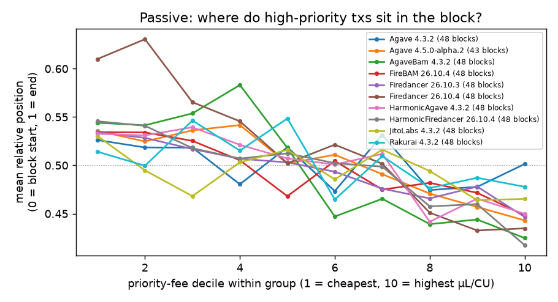
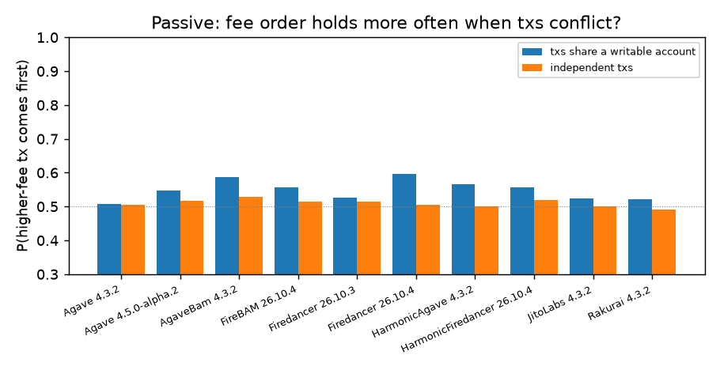
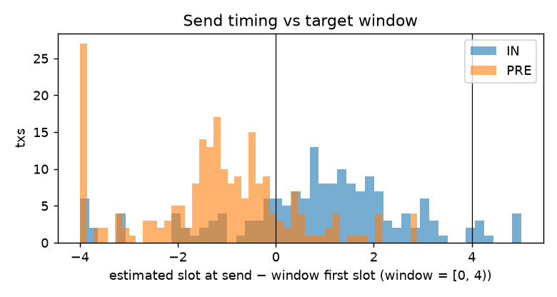

# Results (auto-generated by `python -m itb analyze` — do not edit by hand)

## Data and dates

- Cluster survey: 2026-10-24T00:33:42Z (epoch 1066, 664 voting validators).
- Run `20261024T004419Z-mainnet-dry`: dry-run, 234 probe txs, 2026-10-24 00:44–00:49 UTC.
- Run `20261024T004956Z-mainnet-dry`: dry-run, 150 probe txs, 2026-10-24 00:50–00:53 UTC.
- Blocks fetched: 477 (slots 460539620–460653287, 2026-10-23 18:09–2026-10-24 00:51 UTC). All after the Alpenglow activation (epoch 1064, 21.10.2026).

## Active layer: self-sent probe pairs

**No live probe data yet.** The active path needs a funded keypair (see README → Running live).
Everything below this section is from the passive and timing layers only.

## Passive layer: blocks produced by panel validators

Descriptive only: other senders' arrival times are unknown, so this cannot separate fee ordering from
arrival order. Jito-tip txs and failed txs excluded. Spearman ρ < 0 means higher fee → earlier.

| group | validators | blocks | median txs/block | Spearman(position, µL/CU) | same, first 64 txs | same, first 64 txs of the window's 1st block | P(fee order) conflicting | P(fee order) independent |
|---|---|---|---|---|---|---|---|---|
| Agave 4.3.2 | 2 | 48 | 397 | -0.02 [-0.05, 0.02] | -0.08 [-0.13, -0.03] | -0.15 [-0.27, -0.04] | 0.51 [0.49, 0.53] | 0.50 [0.49, 0.52] |
| Agave 4.5.0-alpha.2 | 2 | 43 | 411 | -0.04 [-0.09, -0.00] | -0.09 [-0.16, -0.04] | -0.10 [-0.23, 0.03] | 0.55 [0.51, 0.60] | 0.52 [0.50, 0.53] |
| AgaveBam 4.3.2 | 2 | 48 | 337 | -0.08 [-0.10, -0.06] | -0.36 [-0.42, -0.31] | -0.57 [-0.64, -0.49] | 0.59 [0.56, 0.61] | 0.53 [0.52, 0.54] |
| FireBAM 26.10.4 | 2 | 48 | 401 | -0.04 [-0.07, -0.01] | -0.26 [-0.33, -0.19] | -0.41 [-0.55, -0.26] | 0.56 [0.54, 0.57] | 0.51 [0.50, 0.52] |
| Firedancer 26.10.3 | 2 | 48 | 368 | -0.04 [-0.06, -0.02] | -0.10 [-0.15, -0.05] | -0.29 [-0.41, -0.19] | 0.53 [0.50, 0.55] | 0.52 [0.51, 0.52] |
| Firedancer 26.10.4 | 2 | 48 | 456 | -0.02 [-0.06, 0.01] | -0.01 [-0.08, 0.06] | 0.08 [-0.06, 0.23] | 0.60 [0.58, 0.61] | 0.51 [0.49, 0.52] |
| HarmonicAgave 4.3.2 | 2 | 48 | 413 | -0.01 [-0.04, 0.03] | -0.09 [-0.12, -0.06] | -0.03 [-0.12, 0.05] | 0.57 [0.53, 0.60] | 0.50 [0.49, 0.51] |
| HarmonicFiredancer 26.10.4 | 2 | 48 | 421 | -0.04 [-0.08, -0.01] | -0.11 [-0.18, -0.05] | -0.03 [-0.18, 0.12] | 0.56 [0.52, 0.59] | 0.52 [0.51, 0.53] |
| JitoLabs 4.3.2 | 2 | 48 | 305 | 0.00 [-0.02, 0.03] | -0.06 [-0.11, -0.01] | -0.16 [-0.25, -0.08] | 0.52 [0.50, 0.55] | 0.50 [0.49, 0.51] |
| Rakurai 4.3.2 | 2 | 48 | 368 | 0.02 [-0.01, 0.05] | -0.02 [-0.07, 0.02] | -0.01 [-0.14, 0.10] | 0.52 [0.48, 0.57] | 0.49 [0.48, 0.50] |

## Timing layer: did sends hit the target window?

384 sends. Estimated slot at send relative to window start: median -0.42, 5–95 % [-4.64, 2.95] slots. Share inside [−1.5, 4): 73%. Sent > 50 ms after plan (pair excluded, amendment A1): 6.0%.

Aim error by phase and path (slots; PRE targets −1.2, IN targets +0.5…+2.4):

| phase   | path   |   count |   25% |   50% |   75% |
|:--------|:-------|--------:|------:|------:|------:|
| IN      | RPC    |   24.00 | -2.29 | -0.38 |  1.11 |
| IN      | TPU    |  142.00 |  0.17 |  1.13 |  2.03 |
| PRE     | RPC    |   30.00 | -1.55 | -1.28 | -0.81 |
| PRE     | TPU    |  188.00 | -2.02 | -1.13 | -0.35 |

## Figures

