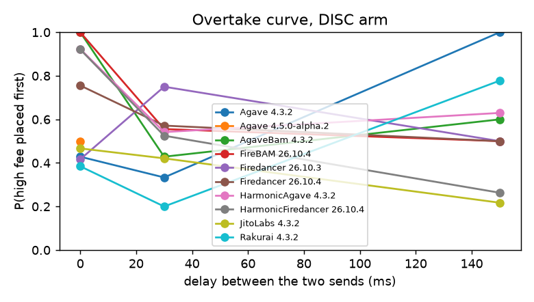

# Results (auto-generated by `python -m itb analyze` — do not edit by hand)

## Data and dates

- Cluster survey: 2026-10-24T12:51:27Z (epoch 1066, 664 voting validators).
- Run `20261024T004419Z-mainnet-dry`: dry-run, 234 probe txs, 2026-10-24 00:44–00:49 UTC.
- Run `20261024T004956Z-mainnet-dry`: dry-run, 150 probe txs, 2026-10-24 00:50–00:53 UTC.
- Run `20261024T015728Z-mainnet-live`: LIVE, 6600 probe txs, 2026-10-24 01:58–04:22 UTC.
- Run `20261024T133021Z-mainnet-live`: LIVE, 6600 probe txs, 2026-10-24 13:31–15:26 UTC.
- Blocks fetched: 11126 (slots 460513252–460900565, 2026-10-23 16:36–2026-10-24 15:26 UTC). All after the Alpenglow activation (epoch 1064, 21.10.2026).

## Active layer: self-sent probe pairs

| group | val. | windows | usable pairs | overtake EQ | overtake DISC | FPI | FIFO | P(RA first) | Holm p | verdict |
|---|---|---|---|---|---|---|---|---|---|---|
| Agave 4.3.2 | 4 | 73 | 148 | 0.30 [0.16, 0.45] | 0.43 [0.24, 0.62] | 0.13 [-0.13, 0.39] | 0.41 [0.11, 0.68] | 0.54 [0.33, 0.74] | 0.33 | mixed / weak |
| Agave 4.5.0-alpha.2 | 3 | 7 | 16 | 0.00 [0.00, 0.00] | 0.50 [0.00, 1.00] | – | – | 1.00 [1.00, 1.00] | nan | insufficient data |
| AgaveBam 4.3.2 | 5 | 173 | 388 | 0.48 [0.36, 0.61] | 0.70 [0.60, 0.80] | 0.22 [0.06, 0.38] | 0.03 [-0.21, 0.28] | 0.49 [0.36, 0.62] | 0.016 | mixed / weak |
| FireBAM 26.10.4 | 5 | 44 | 93 | 0.27 [0.10, 0.47] | 0.67 [0.43, 0.86] | 0.39 [0.08, 0.67] | 0.45 [0.05, 0.80] | 0.53 [0.26, 0.77] | 0.0352 | mixed / weak |
| Firedancer 26.10.3 | 2 | 53 | 123 | 0.56 [0.33, 0.78] | 0.53 [0.36, 0.71] | – | – | 0.30 [0.10, 0.50] | nan | insufficient data |
| Firedancer 26.10.4 | 5 | 220 | 519 | 0.63 [0.51, 0.74] | 0.62 [0.53, 0.71] | -0.01 [-0.16, 0.14] | -0.26 [-0.49, -0.01] | 0.49 [0.39, 0.59] | 0.565 | mixed / weak |
| HarmonicAgave 4.3.2 | 5 | 221 | 488 | 0.36 [0.26, 0.47] | 0.69 [0.61, 0.78] | 0.33 [0.20, 0.46] | 0.28 [0.06, 0.49] | 0.46 [0.37, 0.56] | 0.0014 | mixed / weak |
| HarmonicFiredancer 26.10.4 | 5 | 184 | 390 | 0.34 [0.23, 0.46] | 0.63 [0.53, 0.72] | 0.29 [0.13, 0.43] | 0.31 [0.09, 0.55] | 0.38 [0.28, 0.50] | 0.0024 | mixed / weak |
| JitoLabs 4.3.2 | 5 | 168 | 346 | 0.24 [0.13, 0.36] | 0.38 [0.28, 0.49] | 0.14 [-0.02, 0.30] | 0.52 [0.28, 0.74] | 0.43 [0.29, 0.57] | 0.14 | mixed / weak |
| Rakurai 4.3.2 | 5 | 63 | 139 | 0.16 [0.00, 0.35] | 0.44 [0.26, 0.61] | – | – | 0.50 [0.31, 0.70] | nan | insufficient data |

Landing per arm (survivorship check):

| group                      | arm      |   pairs_sent |   tx_landed_share |   usable_share |   off_target |
|:---------------------------|:---------|-------------:|------------------:|---------------:|-------------:|
| Agave 4.3.2                | CONC     |           61 |              0.59 |           0.39 |            6 |
| Agave 4.3.2                | DISC     |           88 |              0.56 |           0.24 |            8 |
| Agave 4.3.2                | DISC_SEP |           42 |              0.64 |           0.50 |            2 |
| Agave 4.3.2                | EQ       |           69 |              0.70 |           0.54 |            4 |
| Agave 4.3.2                | EQ_SEP   |           45 |              0.66 |           0.47 |            2 |
| Agave 4.3.2                | RATIO_AB |           37 |              0.57 |           0.27 |            5 |
| Agave 4.3.2                | RATIO_BA |           36 |              0.51 |           0.39 |            1 |
| Agave 4.5.0-alpha.2        | CONC     |            1 |              1.00 |           1.00 |            0 |
| Agave 4.5.0-alpha.2        | DISC     |            4 |              0.88 |           0.50 |            0 |
| Agave 4.5.0-alpha.2        | DISC_SEP |            7 |              0.93 |           0.71 |            0 |
| Agave 4.5.0-alpha.2        | EQ       |            4 |              1.00 |           1.00 |            0 |
| Agave 4.5.0-alpha.2        | EQ_SEP   |            1 |              1.00 |           1.00 |            0 |
| Agave 4.5.0-alpha.2        | RATIO_AB |            3 |              1.00 |           1.00 |            0 |
| Agave 4.5.0-alpha.2        | RATIO_BA |            1 |              0.50 |           0.00 |            0 |
| AgaveBam 4.3.2             | CONC     |          134 |              0.63 |           0.36 |           14 |
| AgaveBam 4.3.2             | DISC     |          234 |              0.65 |           0.37 |           24 |
| AgaveBam 4.3.2             | DISC_SEP |          172 |              0.65 |           0.41 |           14 |
| AgaveBam 4.3.2             | EQ       |          154 |              0.62 |           0.43 |           11 |
| AgaveBam 4.3.2             | EQ_SEP   |          112 |              0.65 |           0.40 |           13 |
| AgaveBam 4.3.2             | RATIO_AB |          110 |              0.56 |           0.32 |           12 |
| AgaveBam 4.3.2             | RATIO_BA |           92 |              0.62 |           0.39 |            9 |
| FireBAM 26.10.4            | CONC     |           87 |              0.37 |           0.15 |           13 |
| FireBAM 26.10.4            | DISC     |          135 |              0.36 |           0.16 |           19 |
| FireBAM 26.10.4            | DISC_SEP |           78 |              0.35 |           0.12 |            9 |
| FireBAM 26.10.4            | EQ       |           85 |              0.44 |           0.26 |            9 |
| FireBAM 26.10.4            | EQ_SEP   |           59 |              0.42 |           0.15 |           12 |
| FireBAM 26.10.4            | RATIO_AB |           57 |              0.33 |           0.07 |           10 |
| FireBAM 26.10.4            | RATIO_BA |           66 |              0.47 |           0.23 |           12 |
| Firedancer 26.10.3         | CONC     |           38 |              0.79 |           0.61 |            1 |
| Firedancer 26.10.3         | DISC     |           61 |              0.75 |           0.49 |            7 |
| Firedancer 26.10.3         | DISC_SEP |           37 |              0.72 |           0.41 |            7 |
| Firedancer 26.10.3         | EQ       |           32 |              0.81 |           0.56 |            2 |
| Firedancer 26.10.3         | EQ_SEP   |           30 |              0.80 |           0.47 |            3 |
| Firedancer 26.10.3         | RATIO_AB |           27 |              0.74 |           0.41 |            4 |
| Firedancer 26.10.3         | RATIO_BA |           24 |              0.75 |           0.50 |            4 |
| Firedancer 26.10.4         | CONC     |          133 |              0.77 |           0.47 |           10 |
| Firedancer 26.10.4         | DISC     |          256 |              0.78 |           0.49 |           17 |
| Firedancer 26.10.4         | DISC_SEP |          155 |              0.76 |           0.52 |           14 |
| Firedancer 26.10.4         | EQ       |          146 |              0.80 |           0.50 |           16 |
| Firedancer 26.10.4         | EQ_SEP   |          111 |              0.77 |           0.57 |            7 |
| Firedancer 26.10.4         | RATIO_AB |          102 |              0.79 |           0.53 |           11 |
| Firedancer 26.10.4         | RATIO_BA |          105 |              0.76 |           0.57 |            8 |
| HarmonicAgave 4.3.2        | CONC     |          156 |              0.96 |           0.42 |           53 |
| HarmonicAgave 4.3.2        | DISC     |          239 |              0.97 |           0.48 |           78 |
| HarmonicAgave 4.3.2        | DISC_SEP |          140 |              0.96 |           0.54 |           40 |
| HarmonicAgave 4.3.2        | EQ       |          153 |              0.97 |           0.49 |           45 |
| HarmonicAgave 4.3.2        | EQ_SEP   |           98 |              0.99 |           0.50 |           28 |
| HarmonicAgave 4.3.2        | RATIO_AB |          112 |              0.99 |           0.46 |           40 |
| HarmonicAgave 4.3.2        | RATIO_BA |          113 |              0.95 |           0.50 |           32 |
| HarmonicFiredancer 26.10.4 | CONC     |          152 |              0.95 |           0.37 |           70 |
| HarmonicFiredancer 26.10.4 | DISC     |          235 |              0.96 |           0.41 |           92 |
| HarmonicFiredancer 26.10.4 | DISC_SEP |          152 |              0.98 |           0.32 |           68 |
| HarmonicFiredancer 26.10.4 | EQ       |          172 |              0.98 |           0.39 |           73 |
| HarmonicFiredancer 26.10.4 | EQ_SEP   |          100 |              0.96 |           0.43 |           36 |
| HarmonicFiredancer 26.10.4 | RATIO_AB |           94 |              0.97 |           0.44 |           37 |
| HarmonicFiredancer 26.10.4 | RATIO_BA |           94 |              1.00 |           0.39 |           40 |
| JitoLabs 4.3.2             | CONC     |          159 |              0.62 |           0.34 |           14 |
| JitoLabs 4.3.2             | DISC     |          244 |              0.59 |           0.37 |           18 |
| JitoLabs 4.3.2             | DISC_SEP |          164 |              0.62 |           0.40 |            7 |
| JitoLabs 4.3.2             | EQ       |          148 |              0.60 |           0.34 |           12 |
| JitoLabs 4.3.2             | EQ_SEP   |           95 |              0.63 |           0.35 |            6 |
| JitoLabs 4.3.2             | RATIO_AB |          107 |              0.53 |           0.21 |           10 |
| JitoLabs 4.3.2             | RATIO_BA |           91 |              0.61 |           0.33 |           13 |
| Rakurai 4.3.2              | CONC     |           63 |              0.61 |           0.35 |            6 |
| Rakurai 4.3.2              | DISC     |           74 |              0.63 |           0.43 |            3 |
| Rakurai 4.3.2              | DISC_SEP |           62 |              0.62 |           0.32 |            8 |
| Rakurai 4.3.2              | EQ       |           45 |              0.60 |           0.42 |            4 |
| Rakurai 4.3.2              | EQ_SEP   |           37 |              0.68 |           0.49 |            4 |
| Rakurai 4.3.2              | RATIO_AB |           38 |              0.71 |           0.37 |            4 |
| Rakurai 4.3.2              | RATIO_BA |           32 |              0.53 |           0.44 |            1 |

## Passive layer: blocks produced by panel validators

Descriptive only: other senders' arrival times are unknown, so this cannot separate fee ordering from
arrival order. Jito-tip txs and failed txs excluded. Spearman ρ < 0 means higher fee → earlier.

| group | validators | blocks | median txs/block | Spearman(position, µL/CU) | same, first 64 txs | same, first 64 txs of the window's 1st block | P(fee order) conflicting | P(fee order) independent |
|---|---|---|---|---|---|---|---|---|
| Agave 4.3.2 | 4 | 651 | 341 | -0.02 [-0.02, -0.01] | -0.08 [-0.10, -0.07] | -0.15 [-0.18, -0.12] | 0.53 [0.52, 0.54] | 0.51 [0.50, 0.51] |
| Agave 4.5.0-alpha.2 | 3 | 71 | 385 | -0.04 [-0.07, 0.00] | -0.06 [-0.11, -0.01] | -0.06 [-0.17, 0.05] | 0.55 [0.53, 0.58] | 0.51 [0.50, 0.53] |
| AgaveBam 4.3.2 | 5 | 1580 | 373 | -0.09 [-0.10, -0.09] | -0.33 [-0.34, -0.32] | -0.49 [-0.51, -0.47] | 0.60 [0.60, 0.61] | 0.53 [0.53, 0.54] |
| FireBAM 26.10.4 | 4 | 908 | 363 | -0.06 [-0.07, -0.05] | -0.28 [-0.30, -0.27] | -0.44 [-0.47, -0.42] | 0.57 [0.56, 0.58] | 0.52 [0.52, 0.53] |
| Firedancer 26.10.3 | 2 | 469 | 389 | -0.04 [-0.05, -0.03] | -0.09 [-0.10, -0.07] | -0.26 [-0.30, -0.21] | 0.55 [0.54, 0.56] | 0.52 [0.51, 0.52] |
| Firedancer 26.10.4 | 5 | 1541 | 443 | -0.02 [-0.02, -0.01] | -0.06 [-0.07, -0.04] | -0.07 [-0.10, -0.05] | 0.59 [0.59, 0.60] | 0.50 [0.50, 0.51] |
| HarmonicAgave 4.3.2 | 5 | 1613 | 386 | -0.00 [-0.01, 0.00] | -0.09 [-0.10, -0.08] | -0.08 [-0.10, -0.07] | 0.57 [0.56, 0.57] | 0.50 [0.50, 0.50] |
| HarmonicFiredancer 26.10.4 | 5 | 1571 | 394 | -0.01 [-0.02, -0.01] | -0.10 [-0.11, -0.09] | -0.11 [-0.14, -0.09] | 0.56 [0.56, 0.57] | 0.51 [0.50, 0.51] |
| JitoLabs 4.3.2 | 5 | 1586 | 340 | 0.01 [0.00, 0.02] | -0.03 [-0.04, -0.02] | -0.14 [-0.16, -0.11] | 0.52 [0.52, 0.53] | 0.50 [0.49, 0.50] |
| Rakurai 4.3.2 | 5 | 617 | 366 | 0.00 [-0.01, 0.01] | -0.02 [-0.04, -0.01] | -0.14 [-0.18, -0.11] | 0.56 [0.55, 0.57] | 0.50 [0.49, 0.50] |

## Timing layer: did sends hit the target window?

13422 sends. Estimated slot at send relative to window start: median 0.26, 5–95 % [-3.73, 8.27] slots. Share inside [−1.5, 4): 73%. Sent > 50 ms after plan (pair excluded, amendment A1): 12.0%.

Aim error by phase and path (slots; PRE targets −1.2, IN targets +0.5…+2.4):

| phase   | path   |   count |   25% |   50% |   75% |
|:--------|:-------|--------:|------:|------:|------:|
| IN      | RPC    | 1026.00 |  0.50 |  1.39 |  2.12 |
| IN      | TPU    | 5746.00 |  0.46 |  1.34 |  2.20 |
| PRE     | RPC    | 1002.00 | -1.50 | -0.93 | -0.14 |
| PRE     | TPU    | 5648.00 | -1.58 | -0.95 | -0.10 |

## Figures

