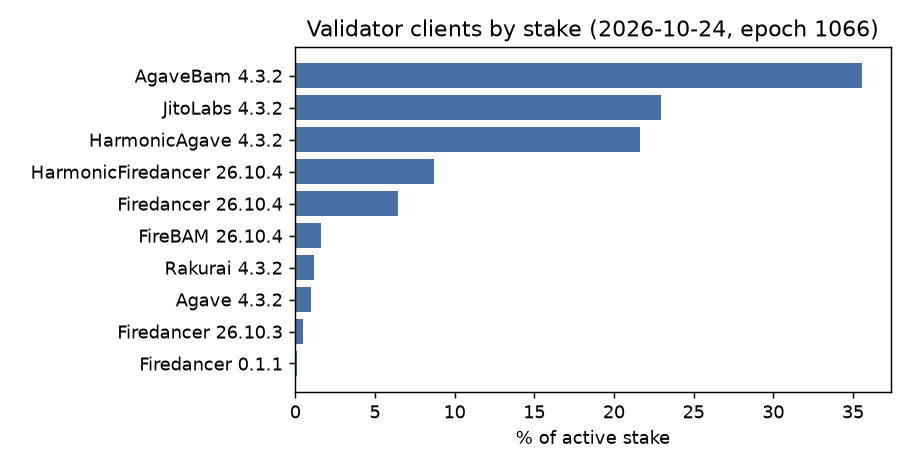
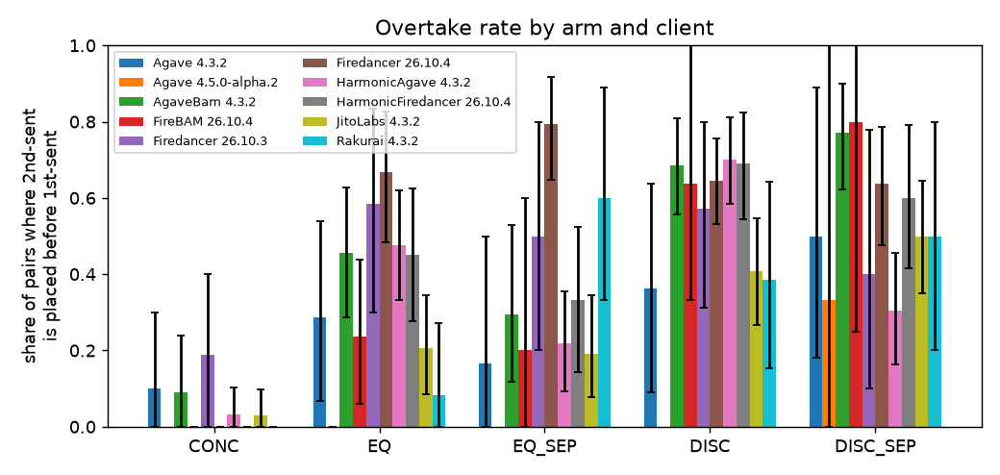
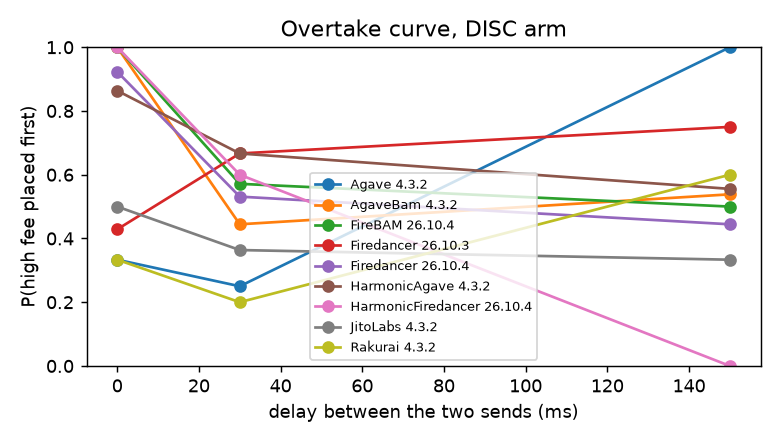
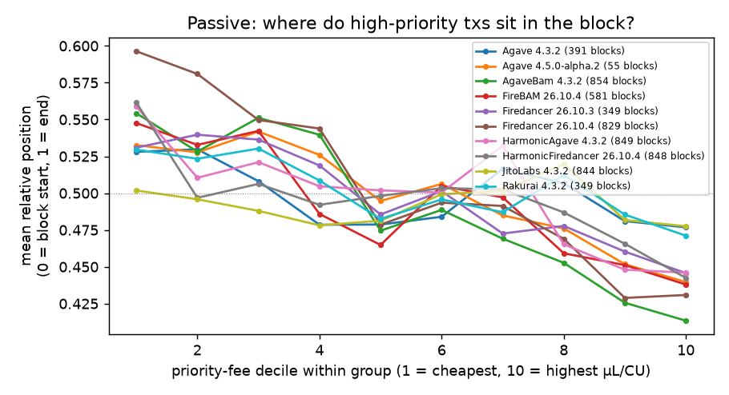
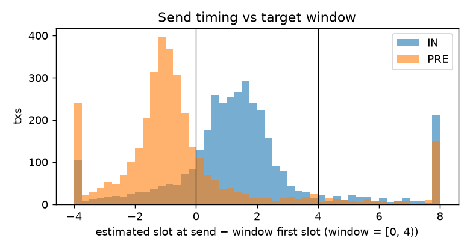

> **Frozen snapshot**: `results.md` as generated at commit 2636fef, before run 2 (live run 1, its dry runs and the passive blocks fetched up to then). The sections of REPORT.md about run 1 quote this file. `itb analyze` now builds [results.md](results.md) from every run in `data/`, so that file pools runs 1 and 2.

# Results (auto-generated by `python -m itb analyze` — do not edit by hand)

## Data and dates

- Cluster survey: 2026-10-24T00:33:42Z (epoch 1066, 664 voting validators).
- Run `20261024T004419Z-mainnet-dry`: dry-run, 234 probe txs, 2026-10-24 00:44–00:49 UTC.
- Run `20261024T004956Z-mainnet-dry`: dry-run, 150 probe txs, 2026-10-24 00:50–00:53 UTC.
- Run `20261024T015728Z-mainnet-live`: LIVE, 6600 probe txs, 2026-10-24 01:58–04:22 UTC.
- Blocks fetched: 6289 (slots 460513252–460713031, 2026-10-23 16:36–2026-10-24 04:22 UTC). All after the Alpenglow activation (epoch 1064, 21.10.2026).

## Active layer: self-sent probe pairs

| group | val. | windows | usable pairs | overtake EQ | overtake DISC | FPI | FIFO | P(RA first) | Holm p | verdict |
|---|---|---|---|---|---|---|---|---|---|---|
| Agave 4.3.2 | 2 | 31 | 62 | 0.29 [0.07, 0.54] | 0.36 [0.09, 0.64] | – | – | 0.27 [0.07, 0.60] | nan | insufficient data |
| Agave 4.5.0-alpha.2 | 2 | 3 | 6 | 0.00 [0.00, 0.00] | – | – | – | 1.00 [1.00, 1.00] | nan | insufficient data |
| AgaveBam 4.3.2 | 2 | 87 | 196 | 0.46 [0.29, 0.63] | 0.69 [0.56, 0.81] | 0.23 [0.00, 0.46] | 0.09 [-0.26, 0.43] | 0.06 [0.00, 0.14] | 0.0786 | mixed / weak |
| FireBAM 26.10.4 | 2 | 24 | 53 | 0.24 [0.06, 0.44] | 0.64 [0.33, 1.00] | – | – | 0.10 [0.00, 0.33] | nan | insufficient data |
| Firedancer 26.10.3 | 2 | 32 | 78 | 0.58 [0.30, 0.83] | 0.57 [0.31, 0.80] | – | – | 0.12 [0.00, 0.29] | nan | insufficient data |
| Firedancer 26.10.4 | 2 | 111 | 268 | 0.67 [0.48, 0.83] | 0.64 [0.53, 0.76] | -0.02 [-0.23, 0.19] | -0.33 [-0.66, 0.03] | 0.17 [0.08, 0.28] | 0.581 | mixed / weak |
| HarmonicAgave 4.3.2 | 2 | 116 | 262 | 0.48 [0.33, 0.62] | 0.70 [0.58, 0.81] | 0.23 [0.05, 0.40] | 0.05 [-0.24, 0.33] | 0.13 [0.04, 0.23] | 0.036 | mixed / weak |
| HarmonicFiredancer 26.10.4 | 2 | 91 | 201 | 0.45 [0.28, 0.62] | 0.69 [0.55, 0.82] | 0.24 [0.02, 0.46] | 0.10 [-0.25, 0.45] | 0.13 [0.04, 0.22] | 0.0616 | mixed / weak |
| JitoLabs 4.3.2 | 2 | 101 | 215 | 0.21 [0.09, 0.34] | 0.41 [0.27, 0.55] | 0.20 [-0.01, 0.41] | 0.59 [0.31, 0.83] | 0.27 [0.12, 0.44] | 0.0786 | mixed / weak |
| Rakurai 4.3.2 | 2 | 29 | 69 | 0.08 [0.00, 0.27] | 0.38 [0.15, 0.64] | – | – | 0.20 [0.00, 0.43] | nan | insufficient data |

Landing per arm (survivorship check):

| group                      | arm      |   pairs_sent |   tx_landed_share |   usable_share |   off_target |
|:---------------------------|:---------|-------------:|------------------:|---------------:|-------------:|
| Agave 4.3.2                | CONC     |           31 |              0.61 |           0.32 |            6 |
| Agave 4.3.2                | DISC     |           47 |              0.54 |           0.23 |            7 |
| Agave 4.3.2                | DISC_SEP |           22 |              0.64 |           0.45 |            1 |
| Agave 4.3.2                | EQ       |           30 |              0.67 |           0.47 |            3 |
| Agave 4.3.2                | EQ_SEP   |           19 |              0.61 |           0.32 |            2 |
| Agave 4.3.2                | RATIO_AB |           17 |              0.44 |           0.24 |            3 |
| Agave 4.3.2                | RATIO_BA |           17 |              0.47 |           0.41 |            1 |
| Agave 4.5.0-alpha.2        | DISC     |            1 |              0.50 |           0.00 |            0 |
| Agave 4.5.0-alpha.2        | DISC_SEP |            4 |              0.88 |           0.75 |            0 |
| Agave 4.5.0-alpha.2        | EQ       |            2 |              1.00 |           1.00 |            0 |
| Agave 4.5.0-alpha.2        | RATIO_AB |            1 |              1.00 |           1.00 |            0 |
| Agave 4.5.0-alpha.2        | RATIO_BA |            1 |              0.50 |           0.00 |            0 |
| AgaveBam 4.3.2             | CONC     |           68 |              0.72 |           0.32 |           12 |
| AgaveBam 4.3.2             | DISC     |          120 |              0.72 |           0.42 |           11 |
| AgaveBam 4.3.2             | DISC_SEP |           79 |              0.65 |           0.44 |            5 |
| AgaveBam 4.3.2             | EQ       |           77 |              0.68 |           0.45 |            7 |
| AgaveBam 4.3.2             | EQ_SEP   |           50 |              0.67 |           0.34 |            8 |
| AgaveBam 4.3.2             | RATIO_AB |           55 |              0.67 |           0.36 |            5 |
| AgaveBam 4.3.2             | RATIO_BA |           49 |              0.56 |           0.33 |            5 |
| FireBAM 26.10.4            | CONC     |           42 |              0.33 |           0.12 |            6 |
| FireBAM 26.10.4            | DISC     |           78 |              0.33 |           0.14 |           11 |
| FireBAM 26.10.4            | DISC_SEP |           41 |              0.32 |           0.12 |            3 |
| FireBAM 26.10.4            | EQ       |           54 |              0.46 |           0.31 |            7 |
| FireBAM 26.10.4            | EQ_SEP   |           33 |              0.48 |           0.15 |            8 |
| FireBAM 26.10.4            | RATIO_AB |           31 |              0.32 |           0.10 |            5 |
| FireBAM 26.10.4            | RATIO_BA |           39 |              0.49 |           0.18 |           10 |
| Firedancer 26.10.3         | CONC     |           26 |              0.85 |           0.62 |            1 |
| Firedancer 26.10.3         | DISC     |           32 |              0.70 |           0.44 |            5 |
| Firedancer 26.10.3         | DISC_SEP |           27 |              0.65 |           0.37 |            3 |
| Firedancer 26.10.3         | EQ       |           22 |              0.82 |           0.55 |            0 |
| Firedancer 26.10.3         | EQ_SEP   |           18 |              0.83 |           0.56 |            1 |
| Firedancer 26.10.3         | RATIO_AB |           19 |              0.74 |           0.42 |            2 |
| Firedancer 26.10.3         | RATIO_BA |           15 |              0.87 |           0.53 |            3 |
| Firedancer 26.10.4         | CONC     |           59 |              0.78 |           0.53 |            5 |
| Firedancer 26.10.4         | DISC     |          145 |              0.80 |           0.52 |           12 |
| Firedancer 26.10.4         | DISC_SEP |           78 |              0.79 |           0.56 |            6 |
| Firedancer 26.10.4         | EQ       |           60 |              0.83 |           0.50 |            6 |
| Firedancer 26.10.4         | EQ_SEP   |           61 |              0.75 |           0.56 |            5 |
| Firedancer 26.10.4         | RATIO_AB |           52 |              0.78 |           0.52 |            4 |
| Firedancer 26.10.4         | RATIO_BA |           43 |              0.81 |           0.60 |            3 |
| HarmonicAgave 4.3.2        | CONC     |           68 |              0.99 |           0.46 |           22 |
| HarmonicAgave 4.3.2        | DISC     |          119 |              0.98 |           0.56 |           28 |
| HarmonicAgave 4.3.2        | DISC_SEP |           63 |              1.00 |           0.57 |           22 |
| HarmonicAgave 4.3.2        | EQ       |           81 |              0.98 |           0.52 |           24 |
| HarmonicAgave 4.3.2        | EQ_SEP   |           54 |              1.00 |           0.59 |           14 |
| HarmonicAgave 4.3.2        | RATIO_AB |           58 |              1.00 |           0.48 |           23 |
| HarmonicAgave 4.3.2        | RATIO_BA |           55 |              0.95 |           0.47 |           16 |
| HarmonicFiredancer 26.10.4 | CONC     |           79 |              0.97 |           0.44 |           36 |
| HarmonicFiredancer 26.10.4 | DISC     |          107 |              0.99 |           0.39 |           46 |
| HarmonicFiredancer 26.10.4 | DISC_SEP |           73 |              1.00 |           0.34 |           34 |
| HarmonicFiredancer 26.10.4 | EQ       |           80 |              1.00 |           0.39 |           37 |
| HarmonicFiredancer 26.10.4 | EQ_SEP   |           47 |              1.00 |           0.45 |           18 |
| HarmonicFiredancer 26.10.4 | RATIO_AB |           44 |              1.00 |           0.52 |           15 |
| HarmonicFiredancer 26.10.4 | RATIO_BA |           59 |              1.00 |           0.41 |           25 |
| JitoLabs 4.3.2             | CONC     |           86 |              0.65 |           0.38 |            9 |
| JitoLabs 4.3.2             | DISC     |          123 |              0.65 |           0.44 |            6 |
| JitoLabs 4.3.2             | DISC_SEP |           81 |              0.75 |           0.52 |            6 |
| JitoLabs 4.3.2             | EQ       |           70 |              0.69 |           0.49 |            3 |
| JitoLabs 4.3.2             | EQ_SEP   |           53 |              0.74 |           0.49 |            3 |
| JitoLabs 4.3.2             | RATIO_AB |           38 |              0.70 |           0.26 |            3 |
| JitoLabs 4.3.2             | RATIO_BA |           47 |              0.63 |           0.34 |            6 |
| Rakurai 4.3.2              | CONC     |           29 |              0.64 |           0.31 |            5 |
| Rakurai 4.3.2              | DISC     |           27 |              0.50 |           0.48 |            0 |
| Rakurai 4.3.2              | DISC_SEP |           30 |              0.67 |           0.33 |            4 |
| Rakurai 4.3.2              | EQ       |           18 |              0.72 |           0.67 |            0 |
| Rakurai 4.3.2              | EQ_SEP   |           16 |              0.88 |           0.62 |            3 |
| Rakurai 4.3.2              | RATIO_AB |           18 |              0.67 |           0.44 |            1 |
| Rakurai 4.3.2              | RATIO_BA |           12 |              0.67 |           0.58 |            0 |

## Passive layer: blocks produced by panel validators

Descriptive only: other senders' arrival times are unknown, so this cannot separate fee ordering from
arrival order. Jito-tip txs and failed txs excluded. Spearman ρ < 0 means higher fee → earlier.

| group | validators | blocks | median txs/block | Spearman(position, µL/CU) | same, first 64 txs | same, first 64 txs of the window's 1st block | P(fee order) conflicting | P(fee order) independent |
|---|---|---|---|---|---|---|---|---|
| Agave 4.3.2 | 2 | 391 | 347 | -0.01 [-0.02, -0.00] | -0.07 [-0.09, -0.05] | -0.12 [-0.16, -0.08] | 0.53 [0.52, 0.55] | 0.50 [0.50, 0.51] |
| Agave 4.5.0-alpha.2 | 2 | 55 | 411 | -0.05 [-0.09, -0.01] | -0.08 [-0.13, -0.04] | -0.03 [-0.15, 0.10] | 0.55 [0.52, 0.59] | 0.52 [0.50, 0.54] |
| AgaveBam 4.3.2 | 2 | 854 | 370 | -0.09 [-0.10, -0.08] | -0.32 [-0.33, -0.31] | -0.51 [-0.53, -0.49] | 0.60 [0.59, 0.61] | 0.53 [0.53, 0.54] |
| FireBAM 26.10.4 | 2 | 581 | 342 | -0.06 [-0.07, -0.05] | -0.25 [-0.27, -0.23] | -0.41 [-0.44, -0.38] | 0.56 [0.55, 0.57] | 0.52 [0.52, 0.53] |
| Firedancer 26.10.3 | 2 | 349 | 387 | -0.04 [-0.05, -0.03] | -0.08 [-0.10, -0.07] | -0.22 [-0.27, -0.18] | 0.55 [0.54, 0.57] | 0.52 [0.51, 0.52] |
| Firedancer 26.10.4 | 2 | 829 | 440 | -0.02 [-0.03, -0.01] | -0.06 [-0.07, -0.04] | -0.03 [-0.06, 0.01] | 0.59 [0.58, 0.60] | 0.50 [0.50, 0.51] |
| HarmonicAgave 4.3.2 | 2 | 849 | 382 | 0.01 [-0.00, 0.01] | -0.09 [-0.10, -0.08] | -0.08 [-0.11, -0.06] | 0.57 [0.57, 0.58] | 0.50 [0.49, 0.50] |
| HarmonicFiredancer 26.10.4 | 2 | 848 | 395 | -0.01 [-0.01, -0.00] | -0.09 [-0.10, -0.08] | -0.10 [-0.13, -0.07] | 0.57 [0.56, 0.57] | 0.50 [0.50, 0.51] |
| JitoLabs 4.3.2 | 2 | 844 | 331 | 0.01 [0.00, 0.02] | -0.01 [-0.02, 0.00] | -0.12 [-0.16, -0.09] | 0.51 [0.51, 0.52] | 0.50 [0.49, 0.50] |
| Rakurai 4.3.2 | 2 | 349 | 353 | 0.01 [-0.00, 0.02] | -0.01 [-0.02, 0.01] | -0.13 [-0.17, -0.08] | 0.56 [0.54, 0.57] | 0.49 [0.49, 0.50] |

## Timing layer: did sends hit the target window?

6984 sends. Estimated slot at send relative to window start: median 0.21, 5–95 % [-3.72, 8.05] slots. Share inside [−1.5, 4): 73%. Sent > 50 ms after plan (pair excluded, amendment A1): 10.5%.

Aim error by phase and path (slots; PRE targets −1.2, IN targets +0.5…+2.4):

| phase   | path   |   count |   25% |   50% |   75% |
|:--------|:-------|--------:|------:|------:|------:|
| IN      | RPC    |  514.00 |  0.23 |  1.40 |  2.17 |
| IN      | TPU    | 3018.00 |  0.48 |  1.37 |  2.20 |
| PRE     | RPC    |  518.00 | -1.60 | -0.96 | -0.30 |
| PRE     | TPU    | 2934.00 | -1.58 | -0.95 | -0.15 |

## Figures

